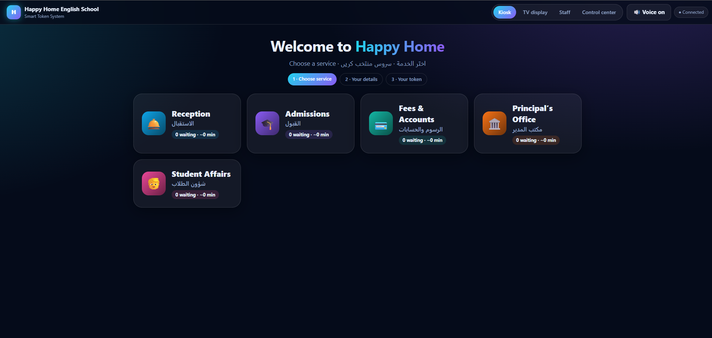

# 🎫 HHES Smart Token System

### A digital queue for the school office: no more crowding at the front desk.

Kiosk · TV display with voice calls · Staff desk · Admin control center · WhatsApp alerts

**Built for [Happy Home English School](https://happyhomeenglishsch.com)** · Designed, developed and deployed by Shayan

---

> 🔒 **Documentation only.** The source code of this project is private and proprietary. This repository describes what the system does and how it is designed.

## 📌 Table of contents
- [The problem](#-the-problem)
- [The solution](#-the-solution)
- [A visit, step by step](#-a-visit-step-by-step)
- [Screens](#%EF%B8%8F-screens)
- [Features](#-features)
- [Design decisions](#-design-decisions)
- [Tech stack](#%EF%B8%8F-tech-stack)
- [Security and privacy](#-security-and-privacy)
- [What I built and learned](#-what-i-built-and-learned)
- [Roadmap](#%EF%B8%8F-roadmap)
- [License and contact](#-license-and-contact)

---

## 😤 The problem

A school office is busy at admissions time, fee deadlines and report-card days. Parents:

- crowd around one desk and don't know who is next,
- can't tell how long they will wait, so nobody dares leave,
- speak different languages, and staff call names over the noise,
- leave without the school ever learning who visited or why.

## ✅ The solution

**HHES Smart Token System** gives every visitor a numbered token and tells them, on screen, by voice and on WhatsApp, exactly when it is their turn. It runs on the school's **existing web hosting**, with no extra server, no monthly software fee and no special hardware beyond a screen and a receipt printer.

---

## 🚶 A visit, step by step

| # | What happens | Where |
|---|---|---|
| 1️⃣ | The parent taps a service (Reception, Admissions, Fees, Principal, Student Affairs) and chooses a language | **Kiosk** |
| 2️⃣ | A slip prints with the token number (e.g. **F012**) and a **QR code** | **Thermal printer** |
| 3️⃣ | The parent scans the QR, WhatsApp opens, and they press **Send** | **Parent's phone** |
| 4️⃣ | The system replies with their place in line and estimated wait | **WhatsApp** |
| 5️⃣ | The parent sits down, or steps outside, while the TV shows the live queue | **Waiting room** |
| 6️⃣ | Staff press **Call next**. The TV announces the token aloud in the parent's language, and WhatsApp sends "it's your turn" | **TV + WhatsApp** |
| 7️⃣ | Staff mark it started and finished, so the system learns real service times | **Staff desk** |

---

## 🖥️ Screens

| Screen | Purpose |
|---|---|
| **Kiosk** | Visitors choose a service, language and optional priority, then receive a token |
| **TV display** | Shows who is being called and which counter, with voice announcements |
| **Staff desk** | PIN-protected. Call, re-call, start, finish, hold, transfer or mark no-show |
| **Control center** | Admin-only. Counters, settings, message usage and CSV exports |
| **Live tracker** | A page on the parent's own phone showing their position in real time |

<!--
After you upload the screenshots, delete this line and the closing line below to show them:

  
  

  
  

-->

---

## ✨ Features

### 👨‍👩‍👧 For parents and visitors
- Self-service kiosk in **English, Arabic and Urdu**
- **Priority tokens** for those who need to be seen first
- Printed slip with **QR code**
- **WhatsApp updates** on the official Cloud API: confirmation, optional "almost your turn", and "your turn"
- **Phone push alerts** as an alternative
- Live page with position in line and estimated waiting time

### 🧑‍💼 For staff
- One-tap queue control across several counters
- Transfer a visitor to another department without making them queue again
- Hold and resume, re-call, and no-show handling

### 🏫 For school management
- **Five departments**, each with its own numbering (R, A, F, P, S)
- **Smart wait estimates** based on actual service times measured that day
- **Daily reset** with earlier days archived automatically
- **Opt-in lead capture:** verified WhatsApp numbers are saved only with the visitor's consent, and exported on request
- **Monthly message cap** that protects the school from unexpected WhatsApp costs
- **Demo mode** for training staff with fake data

---

## 🧠 Design decisions

**Runs on ordinary shared hosting.** Most small schools can't run a Node server or a database cluster. So the whole system is PHP plus a single SQLite file, uploaded over FTP.

**WhatsApp where the parent messages first.** Instead of asking for phone numbers on a kiosk, the QR code opens WhatsApp with a pre-typed message. The parent's number arrives **already verified**, and replies stay inside WhatsApp's 24-hour service window.

**Three languages from day one.** The kiosk, the printed slip and the voice announcements all support English, Arabic and Urdu, including right-to-left layout.

**One page, four screens.** The whole front end is one lightweight page that switches screens by URL, so the kiosk PC, the TV and staff laptops all load the same thing.

**Safe under pressure.** Queue changes are applied as single transactions, so two staff members pressing "Call next" at the same instant never call the same visitor twice.

**Public view shows the minimum.** The TV and tracker never display names or phone numbers.

---

## 🛠️ Tech stack

| Area | Technology |
|---|---|
| Backend | PHP |
| Database | SQLite |
| Frontend | HTML, CSS and vanilla JavaScript (light and dark themes) |
| Messaging | WhatsApp Business Cloud API |
| Notifications | Web Push with a Service Worker |
| Voice | Browser Speech Synthesis (EN / AR / UR) |
| Printing | 80 mm thermal receipt printer via Chrome kiosk printing |
| Hosting | Standard shared hosting over HTTPS |

---

## 🔐 Security and privacy

- PIN-protected staff and admin areas with **login rate limiting**
- Signed, expiring, HTTP-only session cookies
- **Role-based data access:** public, staff and admin see different information
- Verified WhatsApp webhooks (request signatures are checked)
- Database and settings files are blocked from direct web access
- All database access uses prepared statements
- Spreadsheet-injection protection on every CSV export
- **Consent-first:** contact details are only exported for visitors who agreed to school updates

---

## 📚 What I built and learned

- Designing a real-time-feeling system without WebSockets, using lightweight version-based polling that works on shared hosting
- Integrating the **WhatsApp Cloud API** end to end: webhook verification, signature checks, message limits and the 24-hour window
- Building multilingual, right-to-left interfaces and voice announcements
- Concurrency safety with SQLite transactions
- Delivering a complete project for a real client: requirements, hardware setup, deployment, documentation and staff training

---

## 🗺️ Roadmap

- [ ] SMS fallback for visitors without WhatsApp
- [ ] Analytics dashboard (busiest hours, average waits per department)
- [ ] Appointment pre-booking
- [ ] Parent feedback prompt after service
- [ ] Per-department display boards

---

## 📄 License and contact

**All rights reserved.** The source code is proprietary and is not licensed for copying, modification or redistribution.

Interested in a similar system for your school, clinic or office? Get in touch through my GitHub profile.

Made with ☕ by **Shayan**

